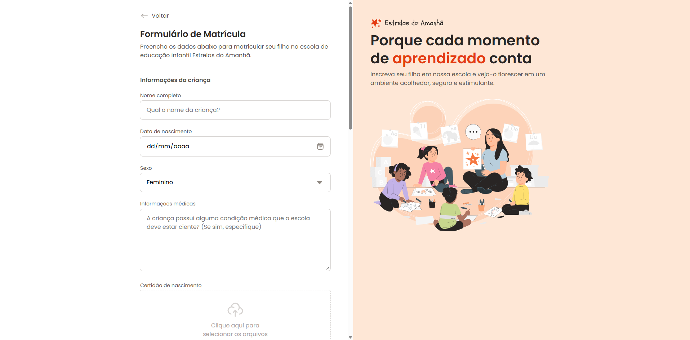

# Formulário de Matrícula

Interface de um formulário de matrícula para a escola infantil **Estrelas do Amanhã**.

Este é um projeto simples de estudo, desenvolvido para praticar HTML e CSS na criação de formulários responsivos.

## Demonstração

### Desktop



### Mobile


## Funcionalidades

- Formulário dividido em seções para facilitar o preenchimento.
- Campos para informações da criança, endereço e responsável.
- Seleção de turno e atividade esportiva.
- Campo para upload da certidão de nascimento.
- Checkbox de termos e condições.
- Validação nativa do campo de e-mail.
- Layout responsivo para diferentes tamanhos de tela.
- Estados visuais de foco, seleção e interação nos campos.

## Tecnologias utilizadas

- HTML5
- CSS3
- CSS Grid e Flexbox
- SVG
- Google Fonts

## Como executar

Como o projeto é uma aplicação estática, não é necessário instalar dependências.

1. Clone o repositório:

```bash
git clone https://github.com/jpfreitas-dev/formulario-de-matricula.git
```

2. Acesse a pasta do projeto:

```bash
cd formulario-de-matricula
```

3. Abra o arquivo `index.html` no navegador.

Também é possível utilizar a extensão **Live Server** no Visual Studio Code para visualizar o projeto durante o desenvolvimento.

## Estrutura do projeto

```text
.
├── assets/
│   ├── icons/
│   ├── desktop-inicio.png
│   ├── mobile-inicio.png
│   ├── Illustration.svg
│   └── logo.svg
├── styles/
│   ├── fields/
│   ├── forms.css
│   ├── global.css
│   ├── index.css
│   └── layout.css
└── index.html
```

## Status do projeto

Concluído como projeto de estudo de HTML e CSS.

## Limitações atuais

- O formulário não possui backend para salvar ou enviar os dados.
- O botão “Salvar respostas” ainda não possui comportamento implementado.
- O upload de arquivo é apenas visual e não realiza processamento.
- Alguns dados do endereço são apresentados como valores fixos.

## Aprendizados

Durante o desenvolvimento foram praticados conceitos de estrutura semântica em HTML, organização de estilos em arquivos separados, criação de layouts responsivos, utilização de variáveis CSS e estilização de estados de interação dos elementos do formulário.

